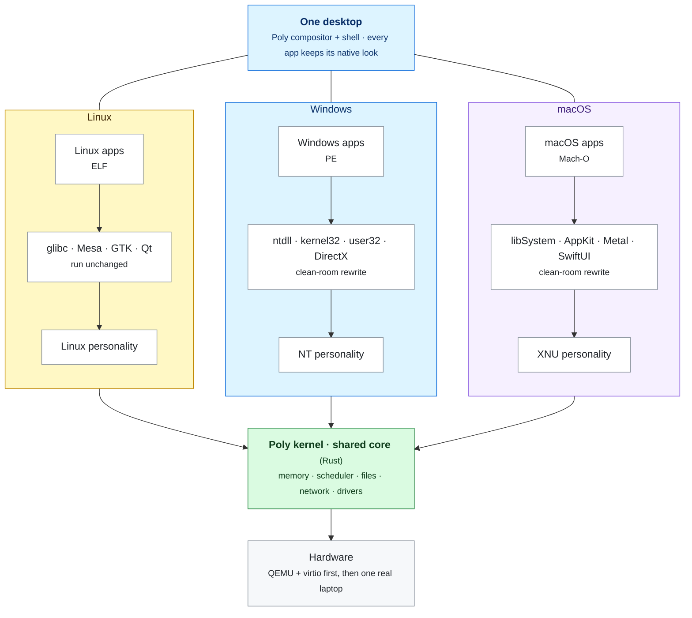

# Poly

An operating system on its own Rust kernel that runs **Linux, Windows and
macOS apps side by side**, each looking exactly like it does on its native OS.

Three native *personalities* (Linux, NT and XNU) share one kernel core. A
process's personality is chosen from its binary format (ELF, PE or Mach-O).
There is no Wine and no Linux underneath. The user-mode Windows DLLs and macOS
frameworks are reimplemented **clean-room** by AI agents that work from specs
verified against the real OS.

> **Status: early, but real programs run.** The kernel boots in QEMU on
> several cores and has its own desktop. Linux programs run on it, from `cat`
> and `grep` to GTK and Qt apps, VLC and Chromium, which is the desktop's
> default browser. The Windows personality is far enough along to run 7-Zip's
> command line with the same results and API calls as on real Windows; Chrome
> for Windows is the current goal and does not run yet. For macOS only the
> groundwork exists; no macOS app runs. See the [roadmap](docs/ROADMAP.md).

## What works today

| | State |
|---|---|
| **Kernel** | Boots in QEMU (KVM, WHPX or the emulator) on up to 16 cores. Own memory management, scheduler, TCP/IP stack, ext2/ext4, virtio disk, network, GPU, input and sound drivers. |
| **Linux** | The Linux personality implements 353 of the 370 system calls tracked in the [coverage map](#progress). BusyBox, bash, coreutils, Python and a C compiler run, as do GTK 3/4 and Qt 6 apps and VLC with sound. Linux programs match traces recorded on real Linux. |
| **Desktop** | Native Poly user space (compositor, shell, launcher, notifications, settings, Files and Terminal), in the look of [Alpine Shell](docs/adr/0127-the-alpine-shell-look.md): light and dark themes, app icons, editable shortcuts, a busy pointer while an app starts, and it follows the size of the window that shows it. Wayland and X11 (XWayland) apps get windows with Poly's neutral frame (apps that draw their own, like Chromium, keep theirs). |
| **Chromium** | The Debian build of Chromium runs on the desktop as the default browser, with its user-namespace sandbox, and opens web pages over the network ([ADR 0147](docs/adr/0147-the-desktop-from-chromiums-disk-with-chromium-as-the-default-browser.md)). |
| **Windows** | The NT personality has the object manager, memory, processes, registry, files, exceptions and its own `ntdll`, `kernel32`, C runtime, `advapi32`, Winsock and cryptography. 7-Zip's command line passes its recorded scenario, and its trace matches the one recorded on real Windows step by step ([report](docs/windows/7zip-trace.md)). Windows, messages, GDI drawing and text, DirectWrite, input and focus work for test programs on the desktop. The security model and IPC (pipes, completion ports, jobs) that Chrome needs are being built. |
| **Chrome for Windows** | In progress, not running. Specs for it are recorded on real Windows ([gap map](specs/windows/apps/chrome/gap-map.md)); on Poly it still stops early in the browser process, in the setup of Chrome's crash reporting. |
| **macOS** | Groundwork only: a Mach-O reader, an arm64 decoder with a reference interpreter, an aarch64 boot stub, and an import map of what Chrome for macOS needs ([docs/macos](docs/macos/README.md)). |

## How it fits together



Every app talks to the system libraries it was built for. Linux's libraries
are open source and run as they are; the Windows and macOS ones are rewritten
from scratch. Below them, each OS world gets its own *personality* in the
kernel, and all three share one core. More detail in
[docs/ARCHITECTURE.md](docs/ARCHITECTURE.md).

## Progress

<!-- coverage:begin -->
<!-- Generated by `cargo xtask coverage readme` from docs/ROADMAP.md and coverage/. Do not edit. -->

<p>
  <a href="docs/ROADMAP.md"></a>
  
  
  
</p>

**Now:** Phase 5, NT personality and Windows console apps. **Next milestone:** Fallback if needed: our own vcruntime140 (and msvcp140 subsets) per ADR 0055

<a href="docs/ROADMAP.md">
<picture>
  <source media="(prefers-color-scheme: dark)" srcset="docs/progress/roadmap-dark.svg">
  
</picture>
</a>

<picture>
  <source media="(prefers-color-scheme: dark)" srcset="docs/progress/coverage-dark.svg">
  
</picture>

<sub>Block size = amount of work, green = done. The map counts callable functions: kernel calls for all three OSes, plus the system libraries we rewrite for Windows and macOS (Linux's run unchanged). Interfaces behind single calls, such as <code>ioctl</code> codes, <code>/proc</code> files or <code>sysctl</code> names, are tracked as roadmap milestones and added here when app traces show they are used. Libraries that apps bring with them (Microsoft's redistributable C++ and DirectX runtimes, <a href="docs/adr/0055-microsoft-redistributables-run-apps-own-copies.md">ADR 0055</a>) are <em>app-provided</em>: left out of the map and of the percentages.</sub>

<details>
<summary>Coverage numbers</summary>

| OS | API coverage | App-weighted | Traces passing |
|---|---:|---:|---:|
| Linux | 88.5% | n/a | 0 / 0 |
| Windows | 0.3% | n/a | 0 / 0 |
| macOS | 0.0% | n/a | 0 / 0 |

| OS | Layer | Entries | Green | Stub | Claimed | Missing | N/A by design | App-provided |
|---|---|---:|---:|---:|---:|---:|---:|---:|
| Linux | syscalls | 370 | 353 | 0 | 8 | 3 | 6 | 0 |
| Linux | user-mode API | 35 | 0 | 0 | 35 | 0 | 0 | 0 |
| Windows | NT + win32k system services | 1,811 | 0 | 0 | 3 | 1,808 | 0 | 0 |
| Windows | user-mode DLL exports | 130,198 | 183 | 4 | 3,034 | 53,701 | 0 | 73,276 |
| macOS | BSD syscalls + Mach traps | 517 | 0 | 0 | 0 | 517 | 0 | 0 |
| macOS | framework API | 741,217 | 0 | 0 | 0 | 741,217 | 0 | 0 |

*API coverage* is green entries out of the entries that are ours to build: *app-provided* entries (libraries the application or its installer supplies, ADR 0055) are listed under *Entries* but left out of the percentages, and so are entries *not applicable by design* (calls the reference OS itself does not offer on x86-64, or that would replace the running kernel; Poly answers them as the reference does). *App-weighted* counts each API by how often the target apps call it; it is the number that tracks real progress and appears once the call tracer exists.

Seeded from (names only):

- `chrome-win-trace`: Calls Chrome for Testing 157.0.8103.38 (win64) made on real Windows, recorded with the API tracer (specs/windows/apps/chrome) @ `157.0.8103.38`
- `linux-syscall-tbl`: Linux arch/x86/entry/syscalls/syscall_64.tbl @ `f47d223627f80cb7a1eb14c585fe6cb35de5e984`
- `macos-sdk`: macOS SDK .tbd stubs (exported symbols and Objective-C classes) @ `macOS SDK 27.0 (26A425)`
- `ms-learn-dwrite`: Microsoft Learn DirectWrite reference and the public SDK headers dwrite.h .. dwrite_3.h: the COM interfaces and methods of dwrite.dll (entries named Interface.Method) @ `Windows SDK 10.0.26100.0`
- `poly-adr-0132`: Kernel interfaces that Linux package formats need (ADR 0132): squashfs, loop, fuse, overlayfs, namespaces, pivot_root, the new mount API, seccomp; entries named by the spec agents @ `ADR 0132`
- `wine-spec`: Wine .spec export lists (wine-mirror/wine dlls/*/*.spec) @ `840a939ee526137639665ff5f587224d6a36403f`
- `xnu-mach-traps`: XNU osfmk/kern/syscall_sw.c mach_trap_table @ `f6217f891ac0bb64f3d375211650a4c1ff8ca1ea`
- `xnu-syscalls-master`: XNU bsd/kern/syscalls.master @ `f6217f891ac0bb64f3d375211650a4c1ff8ca1ea`

</details>

<!-- coverage:end -->

## Quick start

Needs Rust (the pinned version installs automatically through
`rust-toolchain.toml`) and `qemu-system-x86_64`; `--busybox` takes a
statically linked BusyBox from the host (`busybox-static` on Debian and
Ubuntu) or builds the pinned release.

```sh
cargo xtask start   # a menu of everything that boots: the desktop (with Chromium, on by default), the shells, boot tests, CI
                    # (it remembers your choice: next time Enter runs it again; --last skips the menu)
cargo xtask desktop --chromium # Poly's desktop with Chromium, the default browser (the menu's default; the first
                    # start downloads about 230 MB of Debian packages and makes a 1.3 GB disk image, kept after that)
cargo xtask desktop # the desktop without Chromium, from a small initramfs (no test apps in the image or the launcher)
cargo xtask desktop --test-apps # add the test apps: Poly Demo, Wayland Test Client, Demo Window, Poly Fill, Send Test Notification
cargo xtask run     # boot the kernel in QEMU (Ctrl-A X to quit)
cargo xtask run --busybox   # boot into BusyBox's init and shell (`poweroff` quits; add console=tty1 for the screen)
cargo xtask test    # host unit tests + boot tests in QEMU
cargo xtask boot-tests --list   # the boot test groups; `boot-tests <group>` runs some
cargo xtask ci      # everything CI checks (`ci lint`, `ci host-tests`, ...: one part)
```

On GitHub, CI runs the same parts as parallel jobs: lint, host tests, the boot
tests in 11 shards (`cargo xtask boot-tests --list` shows the groups of each),
the coverage checks and the pipeline checks. It takes about 4 minutes; the one
required check is `ci`, which passes when every other job did.

QEMU runs on the host's hypervisor when it can (much faster): KVM on Linux,
the Windows Hypervisor Platform (WHPX) on Windows (turn on the Windows
feature "Windows Hypervisor Platform"), and on its emulator (TCG)
otherwise; `POLY_QEMU_ACCEL=tcg` forces the emulator. `cargo xtask desktop`
sizes the screen for the host's display (a 200% display gets 2560x1600
drawn at scale 2, so it is sharp); `--size=WxH` and `--scale=N` override it.
`--memory=SIZE` and `--cpus=N` (on `desktop`, `run`, `chromium run`,
`toolkits`, and in the menu's Resources block) give the guest more RAM or
CPUs than its default, up to what the host has (the kernel starts at most 16
CPUs; it has no RAM limit).

On Windows, `cargo xtask run` builds and boots the kernel natively (QEMU
for Windows on the `PATH`). The parts that need a Linux host report so: the
diff runner against real Linux, root disks assembled from Linux packages,
and the boot tests that take screenshots or type through QEMU's Unix
sockets. Run those in WSL or a Linux container; `cargo xtask start` shows
them greyed out with the reason. In Git Bash, `winpty cargo xtask start`
gives the full menu (mintty is not a Windows console; without winpty it
asks with a numbered prompt instead).

## Repository layout

| Path | What |
|---|---|
| `kernel/` | The kernel (its own Cargo workspace): boot, CPU setup, memory, scheduler, drivers, file systems, network, process and syscall routing |
| `crates/` | `no_std` libraries shared with the kernel, unit-tested on the host |
| `personalities/` | Linux, NT (with the Windows DLLs under `nt/win32/`) and XNU system call layers, and the native Poly one |
| `userland/` | The desktop's native programs: compositor, Files, Terminal, notifications and a Wayland demo client |
| `tools/xtask/` | Build, run and test driver |
| `tools/pipeline/` | The agent pipeline: call tracer, diff runner, spec and hand-off tools ([docs](docs/AGENT_PIPELINE.md)) |
| `coverage/` | The coverage map: one file per library or call table |
| `tools/coverage/` | Maintains the coverage map and the progress section above |
| `specs/` | Behaviour specs and visible tests, written from the real OS |
| `tests/` | Test programs run on the real OS and on Poly (Linux and Windows) |
| `docs/` | [Architecture](docs/ARCHITECTURE.md), [decision records](docs/adr/), [project brief](docs/PROJECT_BRIEF.md), [agent pipeline](docs/AGENT_PIPELINE.md), [Windows](docs/windows/) and [macOS](docs/macos/README.md) notes |

## How work gets done

1. A call tracer records which APIs the target apps use; that ranks the work queue.
2. A **spec agent** observes the real OS in a VM and writes a spec plus tests
   (~70% visible, ~30% held out).
3. An **implementer agent**, in a separate context, sees only the spec and the
   visible tests and writes the code.
4. A diff runner runs the tests on the real OS and on Poly. Green merges; red
   goes back to the implementer, and after about 5 rounds to a human.

The rules that keep this legally clean are in **[CLEAN_ROOM.md](CLEAN_ROOM.md)**.

## Contributing

Contributions are welcome, from people and from their AI agents, under the
same clean-room rules the project's own agents follow. Each contributor takes
one role per component, **spec writer** (observes the real OS, writes specs and
tests) or **implementer** (works only from specs and visible tests), never both.
What you have read before matters too: for example, someone who has studied
Wine or ReactOS source cannot implement Windows parts. Start with
**[CONTRIBUTING.md](CONTRIBUTING.md)**.

## Roadmap

The full ordered plan, from the kernel core to running on a real laptop, is in
**[docs/ROADMAP.md](docs/ROADMAP.md)**: 12 phases, one checkbox per milestone.
The chart under [Progress](#progress) is generated from it.

<!-- roadmap:begin -->
<!-- Generated by `cargo xtask coverage readme` from docs/ROADMAP.md. Do not edit. -->

| Phase | What it delivers | Milestones |
|---|---|---|
| 0 | Foundation | 11 of 11 ✅ |
| 1 | Kernel core | 14 of 14 ✅ |
| 2 | Kernel terminal | 5 of 5 ✅ |
| 3 | User space and the first Linux program | 12 of 12 ✅ |
| 4 | Linux userland | 18 of 18 ✅ |
| 5 | NT personality and Windows console apps | 18 of 19 |
| 6 | Graphics, input, audio and the desktop | 20 of 21 |
| 7 | Windows GUI apps | 0 of 14 |
| 8 | Integration bridges | 2 of 16 |
| 9 | XNU personality and macOS foundations | 4 of 17 |
| 10 | macOS GUI apps and Liquid Glass | 0 of 10 |
| 11 | Real hardware | 0 of 7 |

<!-- roadmap:end -->

## Known limits

- 100% API coverage does not mean every app works. Undocumented quirks only
  show up in trace replays.
- Kernel-mode anti-cheat, DRM and driver-installing apps may never work.
- Apple services (iCloud, App Store, iMessage, Apple Pay) can be blocked server-side.
- Microsoft and Apple add APIs every year, so the coverage map is a treadmill.
- GPU output cannot match pixel for pixel. Visual tests use a noise floor
  measured on the real OS.

## License

Licensed under the [Apache License 2.0](LICENSE). See [ADR 0005](docs/adr/0005-license.md).
