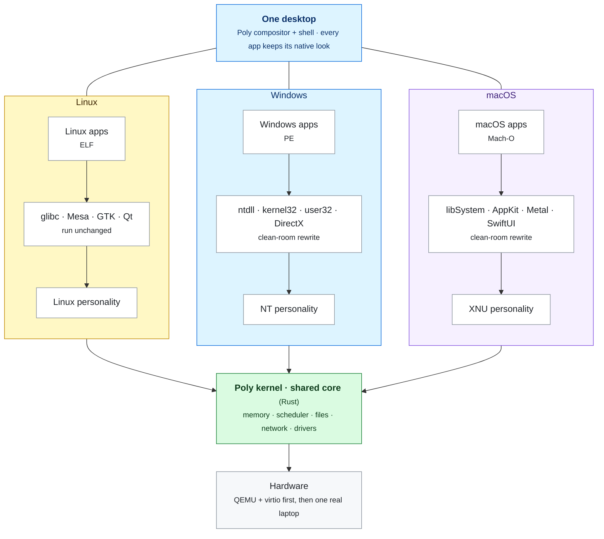
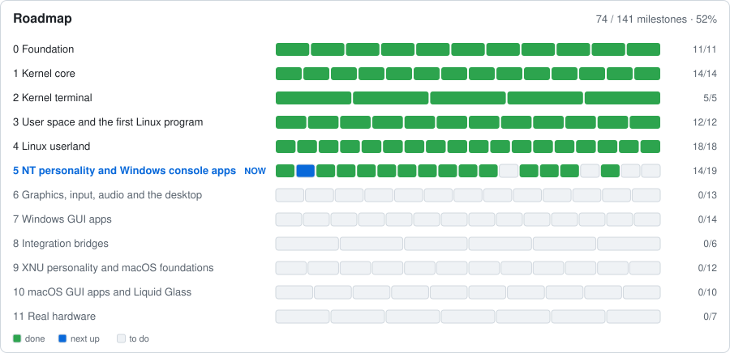
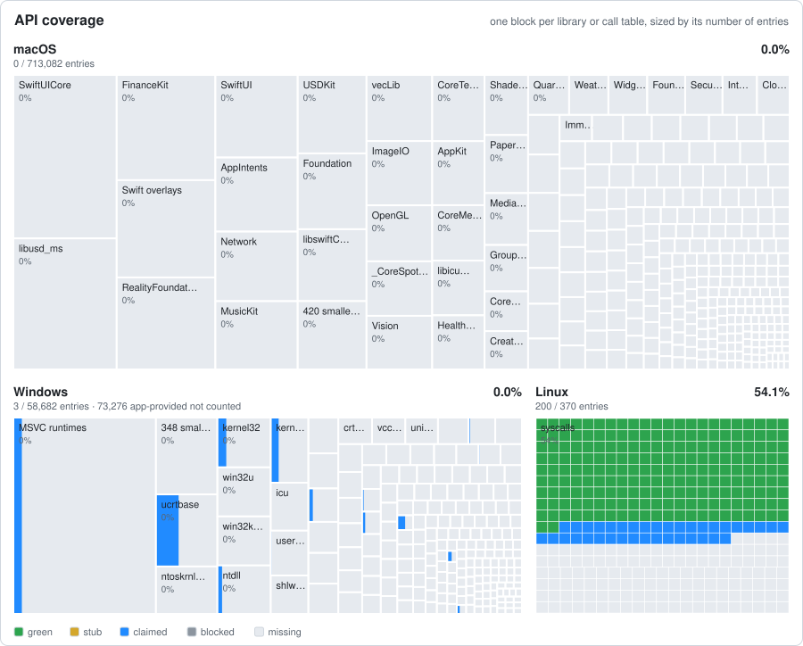

# Poly

An operating system on its own Rust kernel that runs **Linux, Windows and
macOS apps side by side**, each looking exactly like it does on its native OS.

Three native *personalities* (Linux, NT and XNU) share one kernel core. A
process's personality is chosen from its binary format (ELF, PE or Mach-O).
There is no Wine and no Linux underneath. The user-mode Windows DLLs and macOS
frameworks are reimplemented **clean-room** by AI agents that work from specs
verified against the real OS.

> **Status: foundation.** The kernel boots in QEMU, routes system calls by
> personality and tests itself on every boot. No app runs yet. See the
> [roadmap](docs/ROADMAP.md).

## How it fits together



Every app talks to the system libraries it was built for. Linux's libraries
are open source and run as they are; the Windows and macOS ones are rewritten
from scratch. Below them, each OS world gets its own *personality* in the
kernel, and all three share one core. More detail in
[docs/ARCHITECTURE.md](docs/ARCHITECTURE.md).

## Progress

<!-- coverage:begin -->
<!-- Generated by `cargo xtask coverage readme` from docs/ROADMAP.md and coverage/. Do not edit. -->

<p>
  <a href="docs/ROADMAP.md"></a>
  
  
  
</p>

**Now:** Phase 3, User space and the first Linux program. **Next milestone:** Agent pipeline v0: Linux syscall tracer on a real Linux VM, spec agent, implementer agent

<a href="docs/ROADMAP.md">
<picture>
  <source media="(prefers-color-scheme: dark)" srcset="docs/progress/roadmap-dark.svg">
  
</picture>
</a>

<picture>
  <source media="(prefers-color-scheme: dark)" srcset="docs/progress/coverage-dark.svg">
  
</picture>

<sub>Block size = amount of work, green = done. The map counts callable functions: kernel calls for all three OSes, plus the system libraries we rewrite for Windows and macOS (Linux's run unchanged). Interfaces behind single calls, such as <code>ioctl</code> codes, <code>/proc</code> files or <code>sysctl</code> names, are tracked as roadmap milestones and added here when app traces show they are used. Libraries that apps bring with them (Microsoft's redistributable C++ and DirectX runtimes, <a href="docs/adr/0055-microsoft-redistributables-run-apps-own-copies.md">ADR 0055</a>) are <em>app-provided</em>: left out of the map and of the percentages.</sub>

<details>
<summary>Coverage numbers</summary>

| OS | API coverage | App-weighted | Traces passing |
|---|---:|---:|---:|
| Linux | 2.7% | n/a | 0 / 0 |
| Windows | 0.0% | n/a | 0 / 0 |
| macOS | 0.0% | n/a | 0 / 0 |

| OS | Layer | Entries | Green | Stub | Claimed | Missing | Blocked | App-provided |
|---|---|---:|---:|---:|---:|---:|---:|---:|
| Linux | syscalls | 370 | 10 | 0 | 81 | 279 | 0 | 0 |
| Linux | user-mode API | runs unchanged (glibc, Mesa, GTK, Qt) | | | | | | |
| Windows | NT + win32k system services | 1,811 | 0 | 0 | 0 | 1,811 | 0 | 0 |
| Windows | user-mode DLL exports | 130,147 | 0 | 0 | 0 | 56,871 | 0 | 73,276 |
| macOS | BSD syscalls + Mach traps | 517 | 0 | 0 | 0 | 517 | 0 | 0 |
| macOS | framework API | 712,565 | 0 | 0 | 0 | 712,565 | 0 | 0 |

*API coverage* is green entries out of the entries that are ours to build: *app-provided* entries (libraries the application or its installer supplies, ADR 0055) are listed under *Entries* but left out of the percentages. *App-weighted* counts each API by how often the target apps call it; it is the number that tracks real progress and appears once the call tracer exists.

Seeded from (names only):

- `linux-syscall-tbl`: Linux arch/x86/entry/syscalls/syscall_64.tbl @ `f47d223627f80cb7a1eb14c585fe6cb35de5e984`
- `macos-sdk`: macOS SDK .tbd stubs (exported symbols and Objective-C classes) @ `macOS SDK 27.0 (26A425)`
- `wine-spec`: Wine .spec export lists (wine-mirror/wine dlls/*/*.spec) @ `840a939ee526137639665ff5f587224d6a36403f`
- `xnu-mach-traps`: XNU osfmk/kern/syscall_sw.c mach_trap_table @ `f6217f891ac0bb64f3d375211650a4c1ff8ca1ea`
- `xnu-syscalls-master`: XNU bsd/kern/syscalls.master @ `f6217f891ac0bb64f3d375211650a4c1ff8ca1ea`

</details>

<!-- coverage:end -->

## Quick start

Needs Rust (the pinned version installs automatically through
`rust-toolchain.toml`) and `qemu-system-x86_64`; `--busybox` takes a
statically linked BusyBox from the host (`busybox-static` on Debian and
Ubuntu) or builds the pinned release.

```sh
cargo xtask run     # boot the kernel in QEMU (Ctrl-A X to quit)
cargo xtask run --busybox   # boot into BusyBox's init and shell (`poweroff` quits; add console=tty1 for the screen)
cargo xtask test    # host unit tests + boot tests in QEMU
cargo xtask ci      # everything CI checks
```

## Repository layout

| Path | What |
|---|---|
| `kernel/` | The kernel: boot, CPU setup, memory map, process and syscall routing |
| `crates/` | `no_std` libraries shared with the kernel, unit-tested on the host |
| `personalities/` | Linux, NT and XNU system call layers |
| `tools/xtask/` | Build, run and test driver |
| `coverage/` | The coverage map: one file per library or call table |
| `tools/coverage/` | Maintains the coverage map and the progress section above |
| `specs/` | Behaviour specs and visible tests, written from the real OS |
| `docs/` | [Architecture](docs/ARCHITECTURE.md), [decision records](docs/adr/), [project brief](docs/PROJECT_BRIEF.md) |

## How work gets done

1. A call tracer records which APIs the target apps use; that ranks the work queue.
2. A **spec agent** observes the real OS in a VM and writes a spec plus tests
   (~70% visible, ~30% held out).
3. An **implementer agent**, in a separate context, sees only the spec and the
   visible tests and writes the code.
4. A diff runner runs the tests on the real OS and on Poly. Green merges; red
   goes back to the implementer, and after about 5 rounds to a human.

The rules that keep this legally clean are in **[CLEAN_ROOM.md](CLEAN_ROOM.md)**.

## Roadmap

The full ordered plan, from the kernel core to running on a real laptop, is in
**[docs/ROADMAP.md](docs/ROADMAP.md)**: 12 phases, one checkbox per milestone.
The chart under [Progress](#progress) is generated from it.

| Phase | What it delivers |
|---|---|
| 0 | Foundation: boots, routes syscalls, tests itself ✅ |
| 1 | Kernel core: memory, heap, interrupts, timers, scheduler, disk I/O ✅ |
| 2 | Kernel terminal: display and keyboard drivers, an on-screen debug shell |
| 3 | User space: first Linux program runs, agent pipeline v0 |
| 4 | Linux userland: shell, dynamic linking, file system, network, multi-core |
| 5 | NT personality: Windows console apps (7-Zip CLI) |
| 6 | Graphics, input, audio, compositor and shell: Linux GUI apps |
| 7 | Windows GUI apps: user32/gdi32, COM, DirectX, Chrome |
| 8 | Integration bridges: clipboard, drag and drop, one file picker |
| 9 | XNU personality: macOS foundations and command-line tools |
| 10 | macOS GUI apps: AppKit, SwiftUI, Metal, Liquid Glass |
| 11 | Real hardware: UEFI, NVMe, USB, GPU, Wi-Fi on one laptop |

## Known limits

- 100% API coverage does not mean every app works. Undocumented quirks only
  show up in trace replays.
- Kernel-mode anti-cheat, DRM and driver-installing apps may never work.
- Apple services (iCloud, App Store, iMessage, Apple Pay) can be blocked server-side.
- Microsoft and Apple add APIs every year, so the coverage map is a treadmill.
- GPU output cannot match pixel for pixel. Visual tests use a noise floor
  measured on the real OS.

## License

Licensed under the [Apache License 2.0](LICENSE). See [ADR 0005](docs/adr/0005-license.md).
