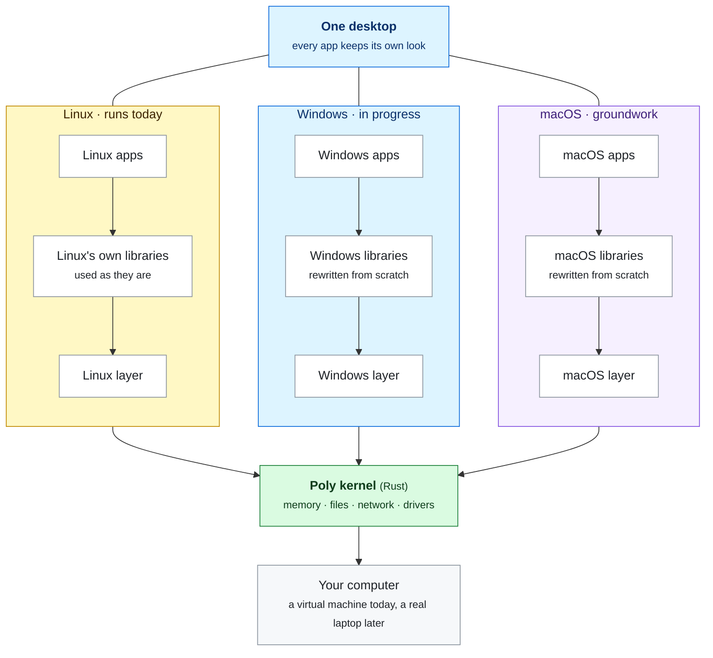

# Poly

Poly runs Windows, macOS and Linux apps. A few apps work on Windows and Linux today; macOS is in progress.

## What works

### Linux

<p>
  
</p>

### Windows

<p>
  &nbsp;&nbsp;&nbsp;
  &nbsp;&nbsp;&nbsp;
  
</p>

## How it works



> [!NOTE]
> **Clean-room implementation:** Poly's kernel and compatibility layers are written from scratch using public documentation, public SDK headers, and black-box observation — never by reading or copying source code from Windows, macOS, Linux, Wine, or ReactOS. See [CLEAN_ROOM.md](CLEAN_ROOM.md).

## Progress

<!-- badges:begin -->
<!-- Generated by `cargo xtask coverage readme` from docs/ROADMAP.md and coverage/. Do not edit. -->

<p>
  <a href="docs/progress/README.md"></a>
  <a href="docs/progress/README.md"></a>
  <a href="docs/progress/README.md"></a>
  <a href="docs/progress/README.md"></a>
</p>

How much of each system's API Poly implements. This is not how many apps work.

<!-- badges:end -->

## Try it

Needs [Rust](https://rustup.rs) and [QEMU](https://www.qemu.org/download/).

```sh
cargo xtask start                          # desktop with Chromium
cargo xtask desktop --release --chrome-win # desktop with Chrome for Windows
```

## Links

[Progress](docs/progress/README.md) · [Roadmap](docs/ROADMAP.md) · [Architecture](docs/ARCHITECTURE.md) · [Running](docs/RUNNING.md) · [Clean-room rules](CLEAN_ROOM.md) · [Contributing](CONTRIBUTING.md) · [Third-party](THIRD_PARTY.md) · [License](LICENSE)
