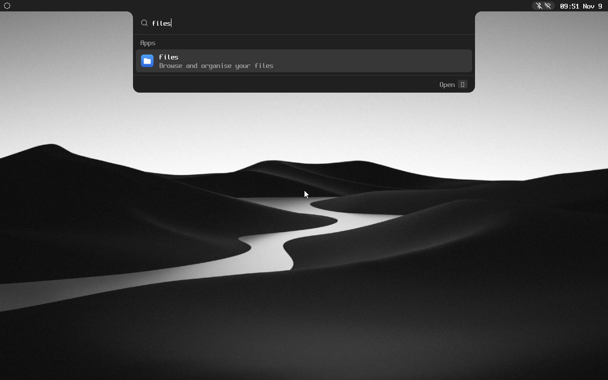
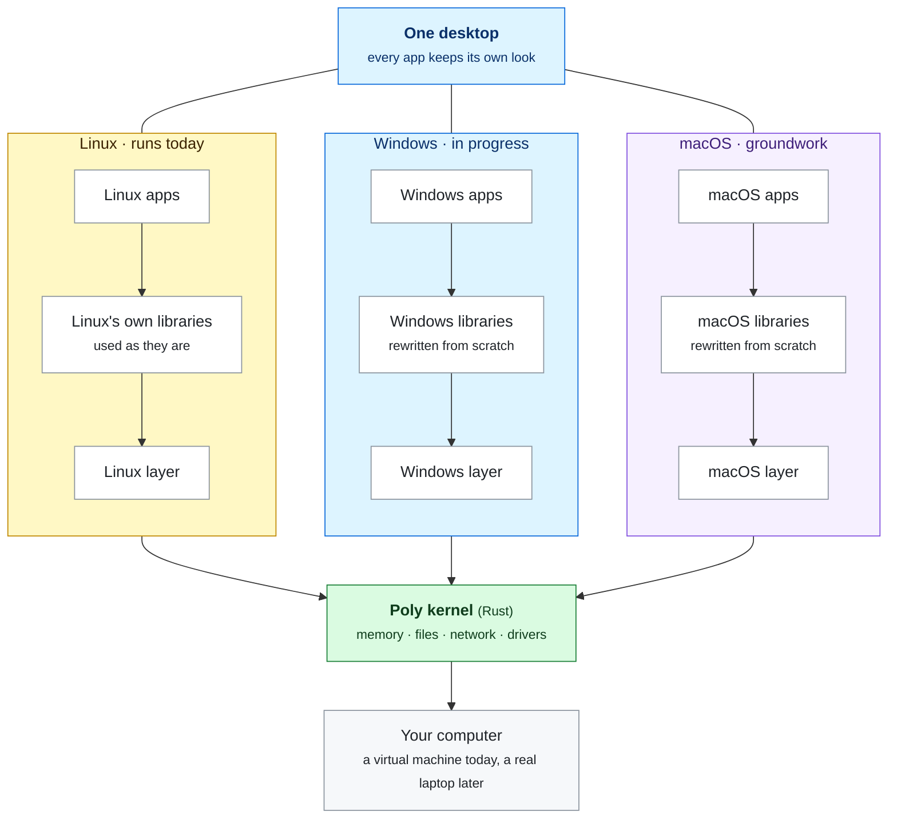
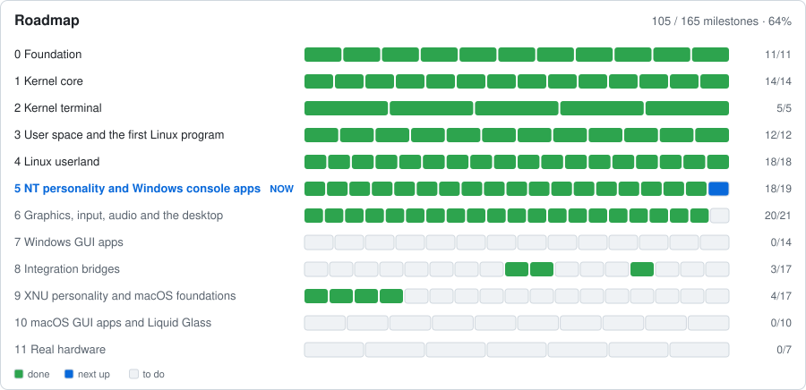
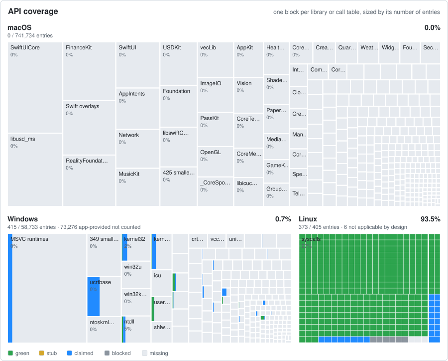

<h1 align="center">Poly</h1>

<p align="center">
  One operating system that runs <b>Linux, Windows and macOS apps side by side</b>.
</p>

<p align="center">
  
</p>

> [!NOTE]
> **Poly is early.** It runs in a virtual machine (QEMU), not yet on real
> hardware. Linux apps run today, including Chromium as the browser. Windows
> is in progress: 7-Zip's command line works, and Chrome for Windows is the
> current goal. For macOS only the groundwork exists.

## What is Poly?

Poly is its own operating system, with its own kernel written in Rust. It is
not Linux with a compatibility layer on top. The kernel speaks the language
of each system directly, so a Linux app, a Windows app and a macOS app each
run as if they were at home, on one desktop.

The Windows and macOS system libraries are written from scratch. They come
only from watching how the real systems behave, never from their code, so
Poly stays legal to share.

## How does it work?



Every app talks to the libraries it was built for. Linux's are open source,
so they run unchanged; the Windows and macOS ones are rewritten. Below them
the kernel has one layer per system (a *personality*), and all three share
the same core. More in [docs/ARCHITECTURE.md](docs/ARCHITECTURE.md).

## How do I try it?

Install [Rust](https://rustup.rs) and [QEMU](https://www.qemu.org/download/), then run:

```sh
cargo xtask start
```

A menu opens. Press Enter to boot Poly's desktop with Chromium; the first
start downloads about 230 MB once. More commands are in
[docs/RUNNING.md](docs/RUNNING.md).

## How far along is it?

<!-- coverage:begin -->
<!-- Generated by `cargo xtask coverage readme` from docs/ROADMAP.md and coverage/. Do not edit. -->

<p>
  <a href="docs/ROADMAP.md"></a>
  
  
  
</p>

**Now:** Phase 5, NT personality and Windows console apps. **Next milestone:** Fallback if needed: our own vcruntime140 (and msvcp140 subsets) per ADR 0055

<a href="docs/ROADMAP.md">
<picture>
  <source media="(prefers-color-scheme: dark)" srcset="docs/progress/roadmap-dark.svg">
  
</picture>
</a>

<picture>
  <source media="(prefers-color-scheme: dark)" srcset="docs/progress/coverage-dark.svg">
  
</picture>

<sub>Block size = amount of work, green = done. The map counts callable functions: kernel calls for all three OSes, plus the system libraries we rewrite for Windows and macOS (Linux's run unchanged). Interfaces behind single calls, such as <code>ioctl</code> codes, <code>/proc</code> files or <code>sysctl</code> names, are tracked as roadmap milestones and added here when app traces show they are used. Libraries that apps bring with them (Microsoft's redistributable C++ and DirectX runtimes, <a href="docs/adr/0055-microsoft-redistributables-run-apps-own-copies.md">ADR 0055</a>) are <em>app-provided</em>: left out of the map and of the percentages.</sub>

<details>
<summary>Coverage numbers</summary>

| OS | API coverage | App-weighted | Traces passing |
|---|---:|---:|---:|
| Linux | 93.5% | n/a | 0 / 0 |
| Windows | 0.7% | n/a | 0 / 0 |
| macOS | 0.0% | n/a | 0 / 0 |

| OS | Layer | Entries | Green | Stub | Claimed | Missing | N/A by design | App-provided |
|---|---|---:|---:|---:|---:|---:|---:|---:|
| Linux | syscalls | 370 | 353 | 0 | 8 | 3 | 6 | 0 |
| Linux | user-mode API | 35 | 20 | 0 | 15 | 0 | 0 | 0 |
| Windows | NT + win32k system services | 1,811 | 0 | 0 | 3 | 1,808 | 0 | 0 |
| Windows | user-mode DLL exports | 130,198 | 400 | 4 | 2,822 | 53,696 | 0 | 73,276 |
| macOS | BSD syscalls + Mach traps | 517 | 0 | 0 | 0 | 517 | 0 | 0 |
| macOS | framework API | 741,217 | 0 | 0 | 0 | 741,217 | 0 | 0 |

*API coverage* is green entries out of the entries that are ours to build: *app-provided* entries (libraries the application or its installer supplies, ADR 0055) are listed under *Entries* but left out of the percentages, and so are entries *not applicable by design* (calls the reference OS itself does not offer on x86-64, or that would replace the running kernel; Poly answers them as the reference does). *App-weighted* counts each API by how often the target apps call it; it is the number that tracks real progress and appears once the call tracer exists.

Seeded from (names only):

- `chrome-win-trace`: Calls Chrome for Testing 157.0.8103.38 (win64) made on real Windows, recorded with the API tracer (specs/windows/apps/chrome) @ `157.0.8103.38`
- `linux-syscall-tbl`: Linux arch/x86/entry/syscalls/syscall_64.tbl @ `f47d223627f80cb7a1eb14c585fe6cb35de5e984`
- `macos-sdk`: macOS SDK .tbd stubs (exported symbols and Objective-C classes) @ `macOS SDK 27.0 (26A425)`
- `ms-learn-dwrite`: Microsoft Learn DirectWrite reference and the public SDK headers dwrite.h .. dwrite_3.h: the COM interfaces and methods of dwrite.dll (entries named Interface.Method) @ `Windows SDK 10.0.26100.0`
- `poly-adr-0132`: Kernel interfaces that Linux package formats need (ADR 0132): squashfs, loop, fuse, overlayfs, namespaces, pivot_root, the new mount API, seccomp; entries named by the spec agents @ `ADR 0132`
- `wine-spec`: Wine .spec export lists (wine-mirror/wine dlls/*/*.spec) @ `840a939ee526137639665ff5f587224d6a36403f`
- `xnu-mach-traps`: XNU osfmk/kern/syscall_sw.c mach_trap_table @ `f6217f891ac0bb64f3d375211650a4c1ff8ca1ea`
- `xnu-syscalls-master`: XNU bsd/kern/syscalls.master @ `f6217f891ac0bb64f3d375211650a4c1ff8ca1ea`

</details>

<!-- coverage:end -->

## How is it built?

Most of the code is written by AI agents in two separate roles. One watches
the real system and writes down what it does, with tests. The other writes
Poly's code from those notes alone. Every test then runs on the real system
and on Poly, and the results must match.

The rules behind this are in [CLEAN_ROOM.md](CLEAN_ROOM.md). To help, start
with [CONTRIBUTING.md](CONTRIBUTING.md).

## What is the plan?

Twelve phases, from the kernel to a real laptop: [docs/ROADMAP.md](docs/ROADMAP.md).

<details>
<summary>The phases and how far each one is</summary>

<!-- roadmap:begin -->
<!-- Generated by `cargo xtask coverage readme` from docs/ROADMAP.md. Do not edit. -->

| Phase | What it delivers | Milestones |
|---|---|---|
| 0 | Foundation | 11 of 11 ✅ |
| 1 | Kernel core | 14 of 14 ✅ |
| 2 | Kernel terminal | 5 of 5 ✅ |
| 3 | User space and the first Linux program | 12 of 12 ✅ |
| 4 | Linux userland | 18 of 18 ✅ |
| 5 | NT personality and Windows console apps | 18 of 19 |
| 6 | Graphics, input, audio and the desktop | 20 of 21 |
| 7 | Windows GUI apps | 0 of 14 |
| 8 | Integration bridges | 2 of 16 |
| 9 | XNU personality and macOS foundations | 4 of 17 |
| 10 | macOS GUI apps and Liquid Glass | 0 of 10 |
| 11 | Real hardware | 0 of 7 |

<!-- roadmap:end -->

</details>

## License

[Apache License 2.0](LICENSE)
