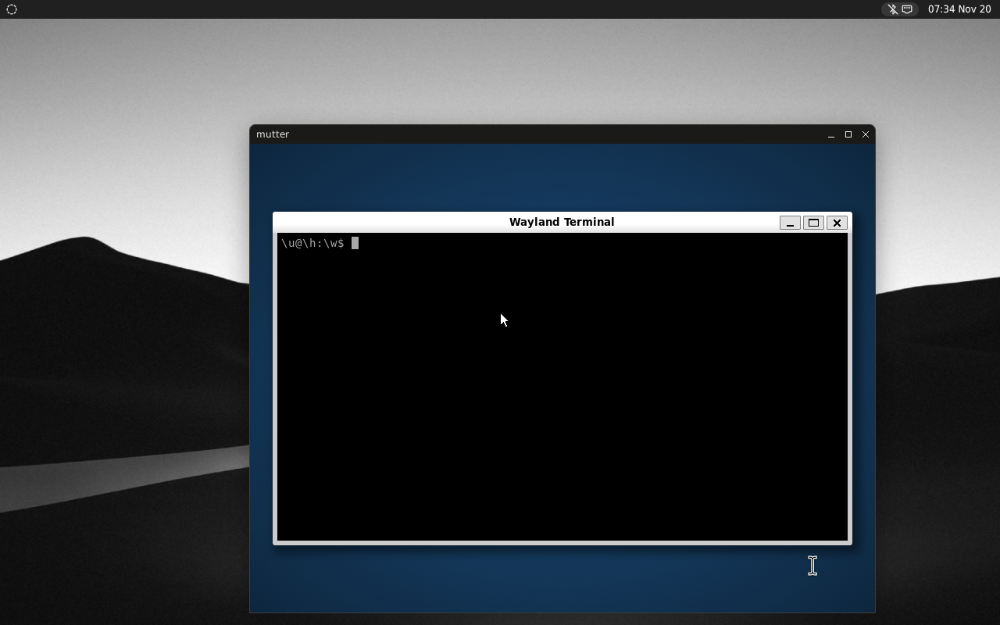

# Desktop choice on Poly: GNOME, KDE Plasma or Poly's own desktop (survey and plan)

Track `survey-desktop-sessions` (survey agent, 2026-11-20). The owner asked: can the user choose the
desktop (Poly's own, GNOME or KDE Plasma) when installing and at login? The owner then narrowed the
question for now: **does it work, and what goes in the roadmap?** Choosing a desktop and the lean OS
installer come later (roadmap Phase 12). This document holds the findings and the batches behind
that phase.

**Inputs:** Debian 13's own packages (weston 14.0.2, seatd, KWin 6.3.6, Mutter 48.7, strace, udev,
dbus, systemd-logind), installed with `apt` inside Poly's guest. Each one was run on Poly in QEMU from
the console of Chromium's Debian disk (`cargo xtask chromium --release --disk-size=8G
follow:FILE`). The evidence is the programs' own logs, `strace` of them on Poly, and the public
documentation (weston(1)/weston-drm(7), seatd(1), the DRM/KMS uAPI and udev man pages,
freedesktop.org's login1 D-Bus API). No compositor, Mesa, systemd or kernel source was read.

## 1. Answer in short

- **Yes, it can work, and the hard part is already there.** Poly's DRM/KMS device carries a foreign
  compositor through mode setting. weston's DRM backend opened `card0` through seatd and
  reported "supports atomic modesetting", "supports GBM modifiers" and GL ES 3.2 on Mesa's llvmpipe.
  After that it stopped at input. Mutter 48 runs today as a window on Poly's desktop, and a Wayland
  app runs inside it (screenshot below).
- **What is missing is the plumbing around the device.** That means the kernel's udev uevent socket,
  a udev database, `/dev/tty0` with VT switching, and a login manager (logind) on a system bus. GNOME
  and Plasma also need their usual session services (polkit, PipeWire, the portals, NetworkManager or
  a stand-in).
- **The first stop was the same for every desktop:**
  `socket(AF_NETLINK, SOCK_RAW, NETLINK_KOBJECT_UEVENT) = -1 EPROTONOSUPPORT`. weston needs it for
  input, KWin needs it to accept the GPU, and systemd-logind won't start without it.
- **Swapping later is cheap** (§7): the desktops stay installed side by side, and *Switch now* is a
  log-out and straight back in, within seconds. Windows (and later macOS) apps can even keep running
  and move to the new desktop, because Poly owns their windows. Linux apps can't, so they restart
  through session restore.

## 2. What Poly already has

| Piece | State on Poly today | Where |
|---|---|---|
| DRM/KMS `card0` and `renderD128` | **Present.** Legacy and **atomic** (TEST_ONLY, NONBLOCK, ALLOW_MODESET), dumb buffers, ADDFB2 with modifiers, PRIME, page-flip and vblank events, GET_CAP/SET_CLIENT_CAP. Not supported: the cursor ioctls, gamma, syncobj, overlay and cursor planes, leases | ADR 0108, 0115, 0116, 0119, 0243 |
| DRM master | The first opener becomes master. SET_MASTER returns EBUSY while another file holds it. poly-compositor holds master for the whole session and never drops it | ADR 0108 |
| evdev `/dev/input/event*` | **Present** (EVIOCGBIT/GABS/GRAB/REVOKE …). poly-compositor GRABs every device | ADR 0103 |
| udev | **Missing:** no `NETLINK_KOBJECT_UEVENT`, no `/sys/class/input`, no `/run/udev/data`. sysfs has the GPU (`/sys/class/drm`, uevent files) | ADR 0103, 0108 |
| VT / seat | Only `/dev/tty1`. **No `/dev/tty0`**, and no VT_SETMODE/VT_ACTIVATE/KDSETMODE/KDSKBMODE | `crates/poly-tty` |
| D-Bus | Session bus present (`dbus-daemon --session` as user `poly`; poly-compositor's own bus for notifications). `dbus-daemon --system` **starts fine when run by hand**, but nothing starts it | ADR 0184 |
| logind, polkit, PAM session | Missing. systemd is on the disk only as a dependency; PID 1 is BusyBox init | ADR 0130 |
| cgroups | Not mounted (logind and `systemd --user` use cgroup v2) | — |
| Mesa | Present: Debian's Mesa 25.0.7 (GBM, EGL, llvmpipe) on the disk; virgl and Venus on the dev root disk | ADR 0115, 0119 |
| Xwayland | Present (started lazily by poly-compositor). Mutter started its own Xwayland on `:1` | ADR 0118, 0184 |
| PipeWire, NetworkManager, xdg-desktop-portal | Missing (ALSA `/dev/snd` is present; the network is set by the kernel) | — |
| Windows apps' windows | Poly's private desktop link `/dev/win32k`, with frames handed over as NT sections. **Not Wayland** | ADR 0128, 0136, 0224 |
| Login screen | None ("Log Out ends without a login screen") | ADR 0117 |

## 3. Experiments: where each desktop stopped

All runs used one boot of the Debian disk: `dpkg --configure -a` (54 s), then `apt-get install
--no-install-recommends weston seatd` (1 min) and `kwin-wayland mutter` (193 packages, 2.5 min),
from the console. Poly's compositor was stopped first (`pkill poly-compositor`), so DRM master
and the input grabs were free and the console had the screen back. The console log of every step is
in the hand-back folder (`console-steps.txt`).

| Run | First stop (evidence) |
|---|---|
| weston 14 `--backend=drm`, seatd (default) | seatd's VT-bound seat: `Could not open tty0 to update VT: No such file or directory`, so the client is never active and opening `/dev/dri/card0` fails with `Operation not permitted`. weston: "no drm device found" |
| the same, `SEATD_VTBOUND=0` (seatd(1)) | **The DRM path works:** "using /dev/dri/card0", "supports atomic modesetting", "supports GBM modifiers", GL ES 3.2 llvmpipe, "Using GL renderer". Then `udev: failed to create the udev monitor` (`socket(AF_NETLINK, …, NETLINK_KOBJECT_UEVENT) = -1 EPROTONOSUPPORT`). "failed to create input devices" is fatal, even with `--continue-without-input` |
| KWin 6.3.6 `kwin_wayland --drm` (root, no logind) | Never opens the device. It enumerates `card0` through libudev, but the uevent socket fails with EPROTONOSUPPORT and `/run/udev/data/c226:0` is ENOENT, so: "failed to open drm device at /dev/dri/card0", "No suitable DRM devices have been found". It made no D-Bus or seat connection in this run |
| Mutter 48.7 `mutter --wayland --display-server` | "Failed to find any matching session": it reads `/run/systemd/users/0` (ENOENT, no logind) and tries `dbus-launch` for a session bus (not installed) |
| systemd-logind by hand (system bus started with `dbus-daemon --system`) | "Failed to create udev watchers: Protocol not supported" (the same uevent socket) |
| KWin nested in Poly's desktop (`kwin_wayland --socket …`) | No window: `DRM_IOCTL_MODE_CREATE_DUMB failed: Permission denied` (its Wayland backend allocates on the render node, where Poly refuses dumb buffers, as Linux does), then "Could not find a suitable render format" |
| **Mutter nested in Poly's desktop** (`dbus-run-session -- mutter --wayland --nested`) | **Runs.** It is a window on Poly's desktop with its own Xwayland on `:1`, and `weston-terminal` runs inside it. Warnings: no `locale1`, no colord, Xwayland glamor falls back to software |

Not tried, to keep within the owner's "light" scope: sway, a full Plasma session
(`startplasma-wayland`) and a full GNOME session (`gnome-session`, `gnome-shell`). Each of them stops
at the same plumbing first.

## 4. Recommendations

### 4.1 How the choice works

- **Session files are the menu.** Each desktop's package installs its entry in
  `/usr/share/wayland-sessions/*.desktop` (freedesktop.org's convention). Poly's own session gets one
  too and stays the default.
- **A login screen of Poly's own** (native, in the Alpine look, part of poly-compositor or a small
  native greeter beside it) lists those sessions and the users, and remembers the last choice per user.
  Logging out comes back to it, so switching desktops needs only a log-out, never a reinstall.
- **Adding a desktop is a package install into the Debian base root** (ADR 0132/0173):
  `apt-get install` of a small task package per desktop (Plasma's, GNOME's). Settings → Desktop offers
  it, and so does the installer's "desktop" step (Phase 12). Removing it is `apt-get remove`
  plus `autoremove`, as for apps (ADR 0180). Poly's own session never depends on it.
- **The greeter hands the screen over.** For a foreign session it gives up DRM master and its input
  grabs, then starts the session under a logind session (PAM, `XDG_SESSION_TYPE=wayland`). When the
  session ends it takes the screen back. That needs a "drop master on hand-over" path in
  poly-compositor and VT semantics in the kernel (batch B1).
- **The login manager: use Debian's own, not a rewrite.** Run Debian's `systemd-udevd`, the system
  `dbus-daemon` and a logind unchanged in the base root, started by Poly's init for a foreign session
  only. Whether that logind is systemd-logind (it expects systemd as PID 1 for session scopes) or
  **elogind** (made for systems without systemd as PID 1) is batch B2's first question. GNOME's
  `gnome-session` also expects a `systemd --user` manager: B4 decides whether Poly runs one for GNOME
  sessions. A clean-room `login1` service of Poly's own (from the public D-Bus API documentation) is
  the fallback if neither runs, and it would be larger.

### 4.2 Windows (and later macOS) apps under GNOME or Plasma

| Option | What it means | Cost | Verdict |
|---|---|---|---|
| **A. Wayland bridge** | A native Poly process (`poly-wl-bridge`) speaks the desktop link (`/dev/win32k`) the way poly-compositor does, and shows each NT top-level as an `xdg_toplevel` (popups as `xdg_popup`) of the foreign compositor. Frames go as `wl_shm` buffers from the NT sections. Input, focus, resize and close go back as link records | M–L: the link's client side moves into a shared crate; sections must be passable as fds; the frame is drawn client-side where the compositor offers no server-side decorations (GNOME offers none, KWin does through `xdg-decoration`) | **Recommended** |
| B. Xwayland | NT windows become X11 clients | Two translations, X11's weaker model (scaling, input); duplicate work | No |
| C. Nested | poly-compositor runs as one window of the foreign desktop and draws Windows apps inside it | Small (poly-compositor needs a Wayland-client output), but the apps live in a box, not on the desktop | Only as an early stopgap |

The bridge is per window, which is what the link already is. Mac apps reach the same link later
(ADR 0107), so they come with it. Under Poly's own session nothing changes.

### 4.3 Poly's own desktop features under a foreign desktop

- **Launcher.** GNOME and Plasma read `/usr/share/applications` and `~/.local/share/applications`.
  Poly writes XDG desktop entries for Linux apps already. Windows (and later Mac) apps need entries
  too, whose `Exec` starts them through the NT personality (ADR 0230's shortcuts → launcher entries).
- **The installers' front door.** Poly's installer is an ordinary app with a desktop file. It
  registers itself as the MIME handler for `.deb`, `.rpm`, AppImage, `.exe`/`.msi` (and later
  `.dmg`/`.pkg`), so a double click in Nautilus or Dolphin opens it as it does in Files.
- **Notifications.** The foreign desktop owns `org.freedesktop.Notifications`. The bridge turns
  Windows notifications (tray balloons, toasts, ADR 0200) into D-Bus notifications, and tray icons into
  StatusNotifierItem (Plasma shows them; GNOME needs an extension).
- **Settings.** Poly's Settings stays an app. Shared settings (scale, keyboard layout, theme) are
  read from the foreign desktop (GSettings or KConfig) for the Windows side's DPI and layout (ADR
  0209, 0231). That is a later polish item.

## 5. Batches

Sizes: S ≈ one agent-day, M ≈ 2–4, L ≈ a week or more. "Spec" marks batches that need a spec agent to
record Linux's behaviour on a real Linux VM (uevent messages, sysfs attributes, VT and DRM-master
ioctl semantics) before an implementer starts.

| Batch | What | Size | Spec | What the user sees |
|---|---|---|---|---|
| **B0 udev in the kernel** | `NETLINK_KOBJECT_UEVENT` (multicast group, the "add"/"remove"/"change" messages, coldplug by writing `add` to a `uevent` file), `/sys/class/input/{eventN,inputN}` with their attributes (name, id, capabilities, `dev`), `/sys/dev/char/13:*`. Then Debian's `systemd-udevd` runs and fills `/run/udev/data` | M | yes | Nothing yet. weston on DRM with keyboard and mouse from the console (a boot test) |
| **B1 VT and seat semantics** | `/dev/tty0`, `/dev/tty2..6`, VT_SETMODE/VT_ACTIVATE/VT_WAITACTIVE/KDSETMODE/KDSKBMODE with the switch signals; DRM master dropped and taken on a VT switch; poly-compositor releases master and its grabs on request. The cursor ioctls/plane (all three compositors use a hardware cursor where one exists) | M | yes | weston and sway on stock seatd (VT-bound); Ctrl+Alt+F-keys between Poly's desktop and a console |
| **B2 Login plumbing** | The system `dbus-daemon`, `systemd-udevd` and elogind or systemd-logind started by Poly's init; cgroup v2 mounted (kernel: the cgroup2 file system, M on its own); PAM session; polkit | M–L | yes (cgroup2) | `kwin_wayland --drm` and `mutter --display-server` start from a logind session |
| **B3 KDE Plasma session** | Plasma's minimal task package in the base root; `startplasma-wayland` from a logind session; fix what stops (expect: PipeWire, `kded`, portals, a network stand-in) | M–L (unknown) | some | Plasma's desktop, started by hand from the console |
| **B4 GNOME session** | `gnome-session`/`gnome-shell`; decide on `systemd --user` for GNOME sessions; the same services as B3 | L (unknown) | some | GNOME Shell, started by hand |
| **B5 Session choice** | Poly's login screen (users, session list from `wayland-sessions`, last choice remembered); hand-over and take-back of the screen; Settings → Desktop installs or removes a desktop | M | no | **The feature:** pick Poly, Plasma or GNOME at login; switch by logging out |
| **B6 Windows apps bridge** | `poly-wl-bridge` (§4.2 A): top-levels, popups, input, focus, client-side frame under GNOME, DPI from the session's scale | M–L | no | Notepad++/Chrome for Windows as normal windows in Plasma and GNOME |
| **B7 Desktop features** | XDG entries for Windows apps, the installer as MIME handler, notifications and tray through D-Bus | S–M | no | Double-click a `.exe` in Dolphin or Nautilus; Windows apps in GNOME's and Plasma's app grids |
| **B8 Lean OS installer** | Six steps: language and keyboard, disk, user, desktop (Poly / GNOME / Plasma), default browser, done. Split into I1–I6 in §6 | see §6 | no | The installer picks the desktop; Poly's stays the default |

B0 and B1 are kernel work and come first. They also help Poly's own desktop: hotplug, and libinput
for Linux apps that open input devices. B3 and B4 are open-ended. They are probes first, with a stop
rule: if one needs more than its batch, record the stops and ask the owner. B6 does not depend on
B3/B4: it can be built and tested under weston (B1).

## 6. Installer flow

The owner's decision (2026-11-20): Poly's OS installer works like Windows' setup, but asks only what
matters. There are no telemetry, account or advertising pages. Everything else gets a sensible
default that can be changed later in Settings.

1. Language and keyboard layout
2. Target disk
3. User name and password
4. Desktop: **Poly (default)** / GNOME / KDE Plasma
5. Default browser: **Chromium (preinstalled)** / Google Chrome / Firefox / …, installed during setup
   if it isn't preinstalled
6. Finish: the first boot goes straight into the chosen desktop

### 6.1 What exists today

There is **no OS installer and no first-boot setup.** Poly runs from disk images that `cargo xtask`
builds on the host. The pieces an installer can build on:

| Piece | Today | Where |
|---|---|---|
| Root file system | Built on the host: Debian 13 packages pinned in `tools/xtask/chromium.lock` (from snapshot.debian.org), unpacked in pure Rust and written by `poly-ext2`'s formatter (`no_std`, so it can run in the guest too). `dpkg --configure -a` runs on the first install of a package (54 s) | ADR 0130, 0147, 0173; `tools/xtask/src/chromium.rs`, `rootdisk.rs` |
| Boot | QEMU PVH, a virtio-blk disk without a partition table. UEFI, NVMe and "Installer, disk encryption, updates" are open in Phase 11 | ADR 0019, roadmap Phase 11 |
| Packages | Poly's installer app runs Debian's own `apt`/`dpkg` with a progress window, reads `.deb`s and the dpkg database (`crates/poly-pkg`), and uninstalls (ADR 0180) | ADR 0132, 0173, 0180; `userland/poly-installer-app` |
| Users | Fixed: the desktop runs as root, and apps run as user `poly` (uid 1000) through `poly-as-user`. The Windows side has one user, `poly` (`RegisteredOwner`, `C:\Users\poly`), and its `InstallDate` is the first boot | ADR 0218, 0066, 0083, 0171 |
| Language | None: the shell is English. The C runtime has locales for Windows programs | ADR 0094 |
| Keyboard | Layouts are data (US, Swiss German, …); the shell's setting reaches Windows programs | ADR 0020, 0209, 0212 |
| Settings | Per user: `~/.config/poly/shell.conf` (`keyboard`, `time_zone`, `scale`, `theme`, wallpaper, volume, shortcuts); unknown keys are kept | ADR 0117, 0179; `crates/poly-shell/src/settings.rs` |
| Default browser | `/etc/xdg/mimeapps.list` names Chromium; `xdg-settings` can change it (ADR 0218 dropped `$BROWSER` so that it can) | ADR 0147, 0218 |

### 6.2 What each step needs

Sizes come from apt on Debian 13 at the snapshot Poly's disk uses, measured in a throwaway
`debian:trixie` container. The base row is Chromium with its recommends: **289 MB to download, 1.1 GB
installed.** The other rows are *extra* on top of that base: the combined total minus the base, so the
shared libraries are counted once.

| Choice | Extra download | Extra installed |
|---|---|---|
| GNOME, Debian's full task (`task-gnome-desktop`) | ~800 MB | ~3.2 GB |
| GNOME core (`gnome-core`) | ~550 MB | ~2.3 GB |
| GNOME bare (shell, session, Files, Terminal, no recommends) | ~90 MB | ~350 MB |
| KDE Plasma, Debian's full task (`task-kde-desktop`) | ~1.4 GB | ~5.0 GB |
| KDE Plasma desktop (`kde-plasma-desktop`) | ~950 MB | ~3.2 GB |
| KDE Plasma bare (workspace, Dolphin, Konsole, no recommends) | ~220 MB | ~710 MB |
| Firefox ESR (`firefox-esr`) | ~110 MB | ~420 MB |
| Google Chrome (Google's `.deb`, from dl.google.com) | 153 MB | not measured (about 13 extra packages, ADR 0218) |

The "bare" sets are lower bounds, not tested desktops. Debian's task packages also bring a full
office suite and games, which "no bloat" leaves out. Each desktop's set is defined in batch B3/B4,
between "bare" and "core".

| Step | What it needs | Default |
|---|---|---|
| **1. Language and keyboard** | Sets the locale (`LANG`, generated by Debian's `locales`); the shell's `keyboard`; the console's layout; XKB for X11 and for foreign desktops (`/etc/default/keyboard`); and the Windows side's user locale and layout (ADR 0094, 0209). Poly's own shell stays English until it has translations: the step sets formats and the apps' language | Guessed from the medium's boot language, US layout |
| **2. Disk** | Lists disks (virtio-blk now, NVMe with Phase 11) and, for "use the whole disk", writes a GPT with an EFI system partition (FAT) and an ext4 root (`poly-ext2` already formats). The root gets a copy of the medium's base root, Poly's files and the boot loader (Phase 11's UEFI boot). Space needed: 1.1 GB base, plus the desktop and browser chosen, plus room to grow; the installer shows the total. No dual-boot editing in the first version | The only or largest disk; a warning that it is wiped |
| **3. User** | A real account: `/etc/passwd`/`shadow` entries made by Debian's own tools (`useradd`, `chpasswd`), a home directory, the groups for video, input and sound, and the same name on the Windows side (`C:\Users\<name>`, its SID, ADR 0171) and later `/Users/<name>`. The desktop and apps then run as that user, not as root and `poly`; this is roadmap Phase 8's "one user home" item | — (asked) |
| **4. Desktop** | Poly's desktop: nothing extra. GNOME or Plasma: its package set (above) installed into the new root with `apt`, plus what Phase 12's B0–B2 make work (udev, seat, logind). Settings → Desktop can add or remove one later | Poly |
| **5. Default browser** | Chromium is already in the base (the base needs a browser to install apps, ADR 0147). Firefox ESR from Debian; Google Chrome from Google's `.deb` (its own apt source, as when a user installs it, ADR 0218). The choice is written to `mimeapps.list` and, for Windows programs, to the shell's URL association (roadmap Phase 8: "file associations") | Chromium |
| **6. Finish** | Writes the default session, logs the new user in automatically **once** (first boot only), and starts the chosen desktop. From the second boot on, the login screen (B5) asks for the password | — |

**Offline or downloaded.** The install medium is Poly's live desktop (today's Debian disk) plus a
local apt repository. Recommended:

- **Standard medium:** the base with Chromium only (about 300 MB of packages). Poly's desktop with
  Chromium installs **with no network**. GNOME, Plasma, Firefox and Chrome are downloaded during setup
  from the pinned snapshot (Google's for Chrome), with the size shown next to each choice. Without a
  network they are greyed out ("needs internet"), and Settings offers them later.
- **Full medium (optional):** the GNOME and Plasma "core" sets and Firefox in the medium's repository,
  about 2.5–3 GB more (the sets overlap, and the combined size is not measured yet). Everything
  installs offline except Google Chrome, which Google distributes only itself.
- Either way the packages are pinned in a lock file like `chromium.lock`, so an installed system is
  the same everywhere. Updates come later through apt (Phase 11's "updates").

### 6.3 How the desktop choice is stored and switched later

- **System default:** `/etc/poly/session.conf` (`default-session=poly|gnome|plasma`), written by the
  installer and by Settings → Desktop.
- **Per user:** the login screen keeps each user's last session in `/var/lib/poly/users/<name>.conf`
  (root-owned, read before anyone logs in), as AccountsService does on other distributions.
- **The sessions themselves** are the `.desktop` files in `/usr/share/wayland-sessions/` (§4.1). Poly's
  own is always there; a desktop's appears when its packages are installed.
- **Switching:** Settings → Desktop → *Switch now* (a quick log-out and straight back in, §7), or pick
  another session on the login screen. Settings → Desktop installs a desktop that isn't there (with
  the same apt progress as the installer) or removes one. Removing the desktop that is someone's last
  choice falls back to Poly's. Poly's own settings (`shell.conf`) stay untouched, whichever desktop is
  used.

### 6.4 Installer batches

| Batch | What | Size | Depends on | What the user sees |
|---|---|---|---|---|
| **I1 Real user accounts** | Accounts made with Debian's tools; the desktop and apps run as the logged-in user; the Windows side's profile and SID follow the user's name | M | — | Poly no longer runs the desktop as root; `C:\Users\<name>` |
| **I2 Language and keyboard** | Locale generation and `LANG`, the keyboard everywhere (shell, console, XKB, Windows side) from one setting | S–M | — | Settings → Region; installer page 1 |
| **I3 Packages during setup** | Lock files for the desktop and browser sets; a local apt repository on the medium plus the snapshot; installing into a target root (`apt` with a root directory, `dpkg --root`), reusing the installer app's progress (ADR 0173) | M | B3/B4 for the desktop sets | Settings → Desktop / Default apps install with progress |
| **I4 Disk and boot** | GPT, EFI system partition, ext4 root, copy of the base, boot loader; the medium as an image built by `cargo xtask` (an installer image beside today's disks) | L | Phase 11 (UEFI, NVMe) | Poly installs onto a real or virtual disk |
| **I5 Setup app** | A native six-page app in the Alpine look, running on the live medium's desktop; the size and network notes per choice; no account, telemetry or ad pages | M | I1–I4 | **The installer** |
| **I6 First boot** | `session.conf`, auto-login once, `mimeapps.list`, then the login screen (B5) | S | I5, B5 | First boot lands in the chosen desktop |

I1 and I2 are worth doing early: they improve Poly's own desktop today. I3 with only the browser
sets (Firefox, Chrome) needs none of the foreign-desktop work, and gives Settings → Default apps. The
GNOME and Plasma choices show up in the installer only once B3/B4 have made those sessions run.

## 7. Quick switching

The owner's requirement (2026-11-20): the desktop can be **swapped quickly later, never by
reinstalling.**

### 7.1 Side by side, a switch in seconds

- **Every chosen desktop stays installed side by side** in the one base root. They are packages, and
  they don't conflict: Poly's session is always there, and GNOME's and Plasma's sessions appear when
  their packages are installed (§6.3). Nothing is removed when the user switches.
- **Settings → Desktop → *Switch now*** (the same switch is on the login screen and in each desktop's
  log-out menu, as a "Poly desktop" entry under GNOME and Plasma):
  1. The running session asks its apps to save and close, as a normal log-out does (§7.2 says what
     comes back).
  2. Before ending, it gives the login screen a **one-time switch ticket**: root-owned, single use,
     valid for about 30 seconds, naming the user and the target session. The user isn't asked for the
     password again.
  3. The login screen starts the target session for the same user straight away and stores it as their
     last choice. The screen hand-over is the B1/B5 path (DRM master and the input grabs move to the
     new compositor).
- **Time:**

  | Session | Start time | Status |
  |---|---|---|
  | Poly's desktop | about 2 s from its start to the first frame | measured in these runs ("desktop up after 2 s") |
  | GNOME / Plasma on llvmpipe | target: under 10 s | not measured yet (B3/B4 measure it) |

  Most of the time is the foreign desktop's own start-up; keeping its services warm is not worth it at
  first.
- **Each desktop keeps its own settings.** They already live apart:

  | Desktop | Its settings |
  |---|---|
  | Poly | `~/.config/poly/shell.conf` |
  | GNOME | dconf (`~/.config/dconf/user`) |
  | Plasma | `~/.config/k*rc` and `plasma*` |

  Three things need care:
  - **Settings both read:** `~/.config/gtk-3.0/settings.ini`, `~/.config/mimeapps.list` and fontconfig.
    The desktop-specific `<desktop>-mimeapps.list` that the XDG MIME spec defines keeps each desktop's
    default apps apart.
  - **Session environment:** Poly's session launcher sets each session's environment
    (`XDG_CURRENT_DESKTOP`, the Qt and GTK theme variables), so nothing leaks from one session into the
    next.
  - **What should follow the user:** keyboard layout, language, time zone and display scale are one
    Poly setting. They are written into GNOME's and Plasma's own settings when such a session starts (a
    one-way sync from Poly's settings), so a switch never shows a different keyboard.

  Autostart entries use `OnlyShowIn`/`NotShowIn` (XDG autostart spec), so Poly's helpers don't start
  inside GNOME or Plasma, and the other way round.

### 7.2 Session restore

| App kind | What comes back after a switch |
|---|---|
| Linux apps under Poly's desktop | Poly records the launcher IDs of the apps that were open when the session ends and starts them again in the new session (in GNOME and Plasma through their autostart, once). Browsers restore their own tabs ("continue where you left off") |
| Linux apps under Plasma | Plasma restores apps that support its session management. Poly's list covers the rest |
| Linux apps under GNOME | GNOME restores little by itself, so Poly's list does it |
| Windows apps | Started again from their launcher entries. Apps that ask Windows to restart them (`RegisterApplicationRestart`, a documented API) get their saved command line back, as on Windows after an update. With the live switch (§7.3) they don't stop at all |

Unsaved work is the app's business, as at any log-out. An app that refuses to close keeps the switch
waiting, and the user can cancel the switch or end the app.

### 7.3 Live switching with windows carried over: feasibility

| App kind | Can its windows move to the new desktop without restarting? | Verdict |
|---|---|---|
| **Windows apps (NT personality)** | **Yes.** Their windows live in Poly's win32k, not in the compositor. The compositor only sees them through the desktop link (`/dev/win32k`), and the frames are NT sections. If the processes outlive the session and the link is handed from poly-compositor to the bridge in the new session (B6), the windows reappear there. Needed: win32k keeps windows when the link drops (no painting until a new opener), a new opener gets the full list of existing windows and their state, and the apps see the change as a display change (scale, size). That is like Windows' own remote-desktop disconnect and reconnect, which apps already handle | **Feasible, M on top of B6.** Needs a spec agent for what Windows sends on a session reconnect (`WM_WTSSESSION_CHANGE`, display and DPI changes) |
| **macOS apps (XNU)** | Same as Windows apps: Poly's window server owns their windows (ADR 0107), so the same hand-over applies | Feasible once Phase 10's window server exists; the design is the same as for Windows apps |
| **Linux Wayland apps** | **No, in general.** A Wayland client's objects (surfaces, buffers, roles) exist only in the one compositor it is connected to. When that compositor goes away, nearly all toolkits end the app (GTK, Chromium/Electron, SDL). Qt 6 can reconnect to a compositor that restarts, but moving to a *different* compositor with different protocols is untested. A proxy that keeps clients connected and replays their state into a new compositor would have to model every protocol and every compositor's differences | **Not feasible as a product feature.** Linux apps close and come back through session restore (§7.2) |
| **Linux X11 apps** | Xwayland ends with its compositor, so they end with it | Not feasible; session restore instead |

**Verdict.** The quick switch (§7.1) and session restore (§7.2) cover everything and are cheap. Carrying
windows over live is realistic for Poly's own Windows and macOS apps, because Poly owns their windows.
It is worth doing after the bridge (B6), and it makes "Switch now" keep every Windows app running.
Linux apps can't be carried over and restart instead. A related, cheap preview is trying GNOME
*nested* inside Poly's desktop: Mutter nested works today (§3), with no log-out at all. It is fine as
"Try GNOME" in Settings, but it is not a switch.

### 7.4 Switching batches

| Batch | What | Size | Spec | What the user sees |
|---|---|---|---|---|
| **S1 Switch now** | The switch ticket, Settings → Desktop → *Switch now* and the entries in the foreign desktops' log-out menus, the per-session environment, `OnlyShowIn` autostarts, the one-way sync of keyboard, language, time zone and scale | S–M (after B5) | no | Poly → Plasma → GNOME → Poly in seconds, each with its own look and settings |
| **S2 Session restore** | The open-app list kept at log-out and replayed in the next session; `RegisterApplicationRestart` for Windows apps | S–M | yes (`RegisterApplicationRestart` behaviour) | The apps that were open come back |
| **S3 Live carry-over for Windows apps** | win32k keeps windows without a link, re-announces them to a new opener, sends the reconnect and display-change messages; the hand-over from poly-compositor to the bridge | M (after B6) | yes (session reconnect messages) | Windows apps stay open and move to the new desktop |
| **S4 Live carry-over for macOS apps** | The same for the XNU window server | S–M (after Phase 10) | — | Mac apps stay open too |

## 8. Risks

- **GNOME and systemd.** Recent GNOME sessions are started by `systemd --user`. Running a user
  manager without systemd as PID 1 is unproven on Poly, and is the biggest unknown here.
- **Disk.** KWin and Mutter alone pulled 193 packages. Full desktops are larger, so the base root
  needs room. The interactive disk's default 4 GB spare (`INTERACTIVE_SPARE_MB`) is too small for
  both; these runs used `--disk-size=8G`.
- **Software rendering.** Without a host GPU, Mutter and KWin run on llvmpipe, which is slow (as
  Chrome is today, ADR 0218). virgl/Venus (ADR 0119) are the way out where the host has a GPU.
- **Explicit sync.** No DRM syncobj: weston disabled it ("missing EGL_ANDROID_native_fence_sync").
  Newer KWin and Mutter prefer it, and B2–B4 will show whether they insist on it.
