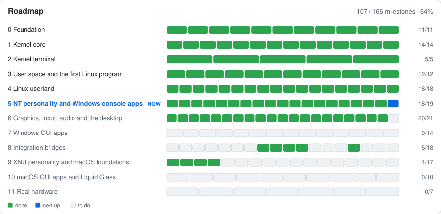
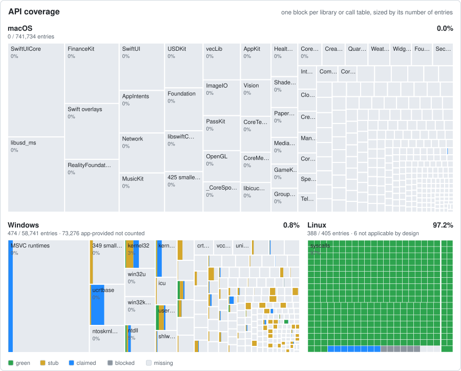

# Progress

Roadmap progress and API coverage for [Poly](../../README.md). See [docs/ROADMAP.md](../ROADMAP.md) for every milestone.

<!-- coverage:begin -->
<!-- Generated by `cargo xtask coverage readme` from docs/ROADMAP.md and coverage/. Do not edit. -->

  
  
  
  

**Now:** Phase 5, NT personality and Windows console apps. **Next milestone:** Our own msvcp140 and siblings, in the order of the names apps import (ADR 0199; first names: threads, time, the throw helpers, _Lockit; the stream classes and locale next)

<a href="../ROADMAP.md">
<picture>
  <source media="(prefers-color-scheme: dark)" srcset="roadmap-dark.svg">
  
</picture>
</a>

<picture>
  <source media="(prefers-color-scheme: dark)" srcset="coverage-dark.svg">
  
</picture>

Block size = amount of work, green = done. The map counts callable functions: kernel calls for all three OSes, plus the system libraries we rewrite for Windows and macOS (Linux's run unchanged). Interfaces behind single calls, such as <code>ioctl</code> codes, <code>/proc</code> files or <code>sysctl</code> names, are tracked as roadmap milestones and added here when app traces show they are used. Libraries that apps bring with them (Microsoft's redistributable C++ and DirectX runtimes, <a href="../adr/0055-microsoft-redistributables-run-apps-own-copies.md">ADR 0055</a>) are <em>app-provided</em>: left out of the map and of the percentages.

Coverage numbers

| OS | API coverage | App-weighted | Traces passing |
|---|---:|---:|---:|
| Linux | 97.2% | n/a | 0 / 0 |
| Windows | 1.7% | n/a | 0 / 0 |
| macOS | 0.0% | n/a | 0 / 0 |

| OS | Layer | Entries | Green | Stub | Claimed | Missing | N/A by design | App-provided |
|---|---|---:|---:|---:|---:|---:|---:|---:|
| Linux | syscalls | 370 | 353 | 0 | 8 | 3 | 6 | 0 |
| Linux | user-mode API | 35 | 35 | 0 | 0 | 0 | 0 | 0 |
| Windows | NT + win32k system services | 1,811 | 0 | 0 | 4 | 1,807 | 0 | 0 |
| Windows | user-mode DLL exports | 130,607 | 1,098 | 3,457 | 3,796 | 52,960 | 0 | 69,296 |
| macOS | BSD syscalls + Mach traps | 517 | 20 | 0 | 79 | 418 | 0 | 0 |
| macOS | framework API | 880,557 | 0 | 0 | 187 | 880,370 | 0 | 0 |

*API coverage* is green entries out of the entries that are ours to build: *app-provided* entries (libraries the application or its installer supplies, ADR 0055) are listed under *Entries* but left out of the percentages, and so are entries *not applicable by design* (calls the reference OS itself does not offer on x86-64, or that would replace the running kernel; Poly answers them as the reference does). *App-weighted* counts each API by how often the target apps call it; it is the number that tracks real progress and appears once the call tracer exists.

Seeded from (names only):

- `chrome-win-trace`: Calls Chrome for Testing 157.0.8103.38 (win64) made on real Windows, recorded with the API tracer (specs/windows/apps/chrome) @ `157.0.8103.38`
- `linux-syscall-tbl`: Linux arch/x86/entry/syscalls/syscall_64.tbl @ `f47d223627f80cb7a1eb14c585fe6cb35de5e984`
- `macos-objc-api`: Objective-C classes, protocols, methods and properties of the macOS SDK frameworks, by name, from clang -extract-api symbol graphs of the public headers (ADR 0187) @ `macOS SDK 27.0 (26A425)`
- `macos-sdk`: macOS SDK .tbd stubs (exported symbols and Objective-C classes) @ `macOS SDK 27.0 (26A425)`
- `macos-swift-interface`: Public Swift API of the macOS SDK modules, by name, from the .swiftinterface files (ADR 0187) @ `macOS SDK 27.0 (26A425)`
- `ms-learn-commctrl`: Microsoft Learn common controls reference and the public SDK header commctrl.h: the window classes of comctl32 and their messages and notifications (entries named by class, version 5.82) @ `Windows SDK 10.0.26100.0`
- `ms-learn-d3d11`: Microsoft Learn Direct3D 11, DXGI and DirectComposition reference and the public SDK headers d3d11*.h, dxgi*.h, dcomp.h, dxcore*.h: the COM interfaces and methods of d3d11.dll, dxgi.dll, dcomp.dll (entries named Interface.Method) @ `Windows SDK 10.0.26100.0`
- `ms-learn-dwrite`: Microsoft Learn DirectWrite reference and the public SDK headers dwrite.h .. dwrite_3.h: the COM interfaces and methods of dwrite.dll (entries named Interface.Method) @ `Windows SDK 10.0.26100.0`
- `ms-learn-eventlog`: Microsoft Learn event logging reference (event sources, EVENTLOGRECORD, the EventLog registry keys) as Chrome's setup.exe uses it, observed by the spec agents (spec-win-chrome-setup); entries named by behaviour @ `Windows 11 25H2 build 26200.9974`
- `ms-learn-input-idle`: Microsoft Learn WaitForInputIdle, ShellExecuteEx (SEE_MASK_WAITFORINPUTIDLE) and the message-queue functions that make a process 'idle for input': what the oracle does for console and GUI processes (entries named by function, the ShellExecuteEx mask by dotted name) @ `Windows 11 build 26300.9974`
- `ms-learn-netfw`: Microsoft Learn Windows Firewall with Advanced Security API (netfw.h: INetFwPolicy2, INetFwRules, INetFwRule) as Chrome's setup.exe uses it to add its inbound mDNS rule, observed by the spec agents (spec-win-chrome-setup); entries named by class @ `Windows 11 25H2 build 26200.9974`
- `ms-learn-setup-files`: Microsoft Learn file, process and snapshot reference (winbase.h, fileapi.h, tlhelp32.h) for what Chrome's own setup.exe calls, observed by the spec agent spec-win-chrome-setup (docs/windows/chrome-setup-plan.md); entries named by function or behaviour @ `Windows 11 25H2 build 26200.9974`
- `ms-learn-shell-download`: Microsoft Learn and the public SDK headers shobjidl_core.h, shellapi.h, shlobj_core.h, fileapi.h, winbase.h: the COM interfaces and methods Chrome's download path uses in shell32.dll, comdlg32.dll (entries named Interface.Method) and the kernel32.dll functions beside them @ `Windows SDK 10.0.26100.0`
- `ms-learn-shell-link`: Microsoft Learn and the public SDK headers shobjidl_core.h, shlobj_core.h, propsys.h, propvarutil.h, objidl.h and the Microsoft format specification MS-SHLLINK: shell links (CLSID_ShellLink, IShellLinkW/A, IPersistFile, IPropertyStore on a link, the .lnk file) as Chrome's setup.exe uses them; entries named Interface or Class.Interface (spec-win-chrome-setup, docs/windows/chrome-installer-plan.md) @ `Windows 11 25H2 build 26200.9974`
- `ms-learn-systemtemp`: Microsoft Learn file system and temporary file reference: the C:\Windows\SystemTemp directory that installers extract into, observed by the spec agents (spec-win-elevation); entries named by directory @ `Windows 11 25H2 build 26200.9974`
- `ms-learn-taskschd`: Microsoft Learn Task Scheduler 2.0 reference and the public SDK headers taskschd.h, winerror.h: the COM interfaces of taskschd.dll (entries named Interface.Method, and Interface.Property for a get/put pair; spec-win-taskschd) @ `Windows SDK 10.0.26100.0`
- `ms-learn-uac`: User Account Control: Microsoft Learn (Access Tokens, Mandatory Integrity Control, ShellExecuteEx, Application Manifests) and the oracle's behaviour for the split token of an administrator: the standard (filtered) token and the elevated (full) token (entries named by the behaviour; docs/windows/chrome-installer-plan.md) @ `Windows 11 build 26200.9974`
- `ms-learn-volume`: Microsoft Learn volume management and CreateFile reference (opening a volume as \\.\C: or \??\C:), observed by the spec agents (spec-win-elevation); entries named by operation @ `Windows 11 25H2 build 26200.9974`
- `ms-learn-winuser`: Microsoft Learn window messages and system commands of user32 (winuser.h): behaviour that is not an export, entries named by message or command (WM_NCHITTEST, WM_ENTERSIZEMOVE, WM_MOUSEHWHEEL, SC_MAXIMIZE; spec-win-input) @ `Windows SDK 10.0.26100.0`
- `poly-adr-0132`: Kernel interfaces that Linux package formats need (ADR 0132): squashfs, loop, fuse, overlayfs, namespaces, pivot_root, the new mount API, seccomp; entries named by the spec agents @ `ADR 0132`
- `windows-audio-w2`: The COM audio interfaces of mmdevapi and audioses that Chrome for Windows calls for shared-mode output (device enumerator, devices, IAudioClient, render client, clock, session control), found by a COM-level trace of Chrome on the Windows oracle (spec-win-wasapi); names from Microsoft Learn, mmdeviceapi.h, audioclient.h and audiopolicy.h @ `Windows 11 26H2 build 26300.9974`
- `windows-com-state`: COM state of a thread and process observed by spec agents on the Windows oracle where Chrome's browser process reaches it (TEB.ReservedForOle, the global interface table, BITS); the names come from Microsoft Learn, objidl.h and bits.h (spec-com-ole-tls) @ `Windows 11 25H2 build 26200.9974`
- `windows-export-probe`: Exported names of Windows 11 system DLLs (kernelbase.dll, userenv.dll) found by spec agents on the oracle where Chrome's sandbox set-up reaches them; names only (spec-chrome-win-s2b) @ `Windows 11 25H2 build 26200.9974`
- `windows-typelib-file`: The binary type-library file (.tlb and the TYPELIB resource of an exe or dll) as ITypeLib and ITypeInfo read it, by black-box observation of files written with CreateTypeLib2 and of the updater's own libraries (docs/windows/typelib-file-format.md; spec-win-typelib-format) @ `Windows 11 25H2 build 26200.9974`
- `wine-spec`: Wine .spec export lists (wine-mirror/wine dlls/*/*.spec) @ `840a939ee526137639665ff5f587224d6a36403f`
- `xnu-mach-traps`: XNU osfmk/kern/syscall_sw.c mach_trap_table @ `f6217f891ac0bb64f3d375211650a4c1ff8ca1ea`
- `xnu-syscalls-master`: XNU bsd/kern/syscalls.master @ `f6217f891ac0bb64f3d375211650a4c1ff8ca1ea`

<!-- coverage:end -->

## Roadmap phases

<!-- roadmap:begin -->
<!-- Generated by `cargo xtask coverage readme` from docs/ROADMAP.md. Do not edit. -->

| Phase | What it delivers | Milestones |
|---|---|---|
| 0 | Foundation | 11 of 11 ✅ |
| 1 | Kernel core | 14 of 14 ✅ |
| 2 | Kernel terminal | 5 of 5 ✅ |
| 3 | User space and the first Linux program | 12 of 12 ✅ |
| 4 | Linux userland | 18 of 18 ✅ |
| 5 | NT personality and Windows console apps | 20 of 21 |
| 6 | Graphics, input, audio and the desktop | 20 of 21 |
| 7 | Windows GUI apps | 2 of 17 |
| 8 | Integration bridges | 5 of 18 |
| 9 | XNU personality and macOS foundations | 7 of 17 |
| 10 | macOS GUI apps and Liquid Glass | 0 of 10 |
| 11 | Real hardware | 0 of 7 |
| 12 | Desktop choice and the lean OS installer | 2 of 18 |

<!-- roadmap:end -->
